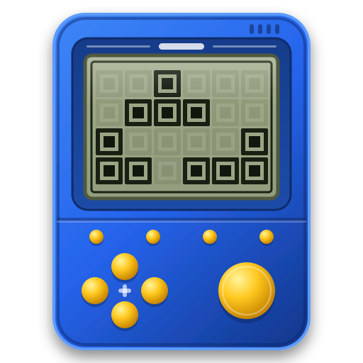

<div align="center">
  
  <h1>BRICK GAME 9999-in-1 Simulator</h1>
  <p>
    <strong>An authentic 90s handheld LCD Brick Game (E-9999) desktop &amp; browser simulator with Xbox/Gamepad rumble, 1-bit piezo buzzer audio, and 7 classic games.</strong>
  </p>
  <p>
    <a href="LICENSE"></a>
    
    
  </p>
</div>

---

> [!NOTE]
> ### 🤖 AI Generation Disclaimer
> **This project was built using AI.** The source code, game engines, 1-bit Web Audio synthesizer, HTML/CSS handheld console UI, vector/raster icons, platform launchers, and documentation were generated and refined with the assistance of AI tools. While reviewed and verified for functionality and open-source licensing compliance, please review the code as you would any community-contributed software.

---

## ✨ Key Features

- **Authentic 10×20 Box-in-Box (`回`) LCD Matrix**: Olive-green backlit LCD canvas with ghost unlit cells, 7-segment `HI-SCORE` / `SCORE` / `SPEED` / `LEVEL` readouts, a 4×4 `NEXT` / `LIVES` subgrid, and classic game-over LCD curtain sweep.
- **7 Classic Handheld Games (Modes A–G)**: Built-in boot menu with animated game previews and configurable starting speed (`1–10`) and level (`1–10`).
- **1-Bit Piezo Buzzer Audio Synthesis**: Zero external audio assets — synthesized in real time via the Web Audio API (square/sawtooth SFX, continuous racing engine pitch, and the classic *Korobeiniki* menu theme).
- **Plug-and-Play Gamepad & Haptic Rumble**: Standard Gamepad API / Xbox 360 (XInput) support with deadzone calibration, tuned DAS/ARR auto-repeat, and dual-motor vibration feedback.
- **Tactile Virtual Console Shell**: Royal-blue E-9999 chassis with yellow buttons that depress in real time from gamepad, keyboard, mouse, or touch input.
- **Persistent High Scores**: Automatically saves per-game high scores locally via `localStorage`.
- **Cross-Platform & Security-Hardened**: Runs natively on Windows and Linux via Electron (`contextIsolation: true`, `nodeIntegration: false`) or directly inside a modern web browser.

---

## 🕹️ Games Included

Switch between all **7 games** on the boot menu (`UP` / `DOWN`), set `LEVEL` (`LEFT`), set `SPEED` (`RIGHT`), and press `START` or `ACTION` to launch:

1. **A — Formula 1 / Brick Racing** (`src/games/racing.js`)
   - 2-lane 10-column highway with downward-scrolling guardrails, non-blocking traffic spawning, 4 lives, speed scaling, and hold-for-**Turbo** boost.
2. **B — Classic Tetris** (`src/games/tetris.js`)
   - Standard 7 tetrominoes (`I`, `O`, `T`, `S`, `Z`, `J`, `L`), center-pivoted rotation with wall/ceiling kicks, controlled soft drop, level-based starting rows (Levels 1–10), flashing line-clear animation, and 4×4 next-piece preview.
3. **C — Tank Battle** (`src/games/tanks.js`)
   - 4-directional 3×3 arena tank combat with destructible brick bunkers, up to 3 enemy patrol tanks, head-on bullet interception, and 4 lives.
4. **D — Barrier Elastic Ball (Breakout)** (`src/games/breakout.js`)
   - Move the bottom paddle across 10 levels (5 repeating fortress/chevron/checkerboard formations), control bounce angle off paddle edges, hold **Action** for turbo ball speed, and 4 lives.
5. **E — Frogs Crossing the River (Frogger)** (`src/games/frogger.js`)
   - Hop your blinking frog across 8 independently timed traffic/river lanes into all 5 home pockets at Row 0 without colliding with hazards or bank walls.
6. **F — Whack-a-Mole (Shooting Gallery)** (`src/games/whack.js`)
   - Slide your bottom T-turret horizontally and rapid-fire upward shots to clear descending target rows before they reach Row 18.
7. **G — Classic Snake** (`src/games/snake.js`)
   - Guide the snake with a 2-step turn input buffer to eat blinking food dots, dodge level obstacles (Levels 2–10), and hold **Action** for turbo speed.

---

## 🎮 Controls & Gamepad Mapping

| Action | Xbox / Standard Gamepad | Keyboard | On-Screen Button |
| :--- | :--- | :--- | :--- |
| **Up / Prev Game / Turbo (Racing)** | `D-Pad Up` / `Left Stick Up` / `Right Stick Up` | `↑` / `W` | `UP` |
| **Down / Soft Drop / Next Game** | `D-Pad Down` / `Left Stick Down` / `Right Stick Down` | `↓` / `S` | `DOWN` |
| **Left / Change Level (Menu)** | `D-Pad Left` / `Left Stick Left` / `Right Stick Left` | `←` / `A` | `LEFT` |
| **Right / Change Speed (Menu)** | `D-Pad Right` / `Left Stick Right` / `Right Stick Right` | `→` / `D` | `RIGHT` |
| **Action / Rotate / Fire / Turbo** | `A`, `B`, `X`, `LB`, `RB`, `LT`, `RT` | `Space` / `Z` | `ROTATE / TURBO` |
| **Start / Pause / Resume** | `Start` | `Enter` / `P` | `START / PAUSE` |
| **Reset / Return to Menu** | `Back` / `Select` | `Esc` / `R` | `RESET` |
| **Mute / Unmute Sound** | `Y` | `M` | `SOUND` |
| **Power On / Off** | — | `O` | `ON/OFF` |

---

## 🚀 Installation & Launching

### Prerequisites
- **[Node.js](https://nodejs.org/) (v22.12+ recommended)** and **npm** for the standalone Electron desktop app.
- *(Optional)* Any modern Chromium/Firefox/Edge browser if you prefer opening `index.html` directly without Electron.

### Clone the Repository
```bash
git clone https://github.com/everydayrandomshit5/brick-game-simulator.git
cd brick-game-simulator
```

### Windows
- **Double-click Launcher**: Double-click `run.bat` (automatically installs dependencies on first run and starts Electron).
- **Terminal**:
  ```powershell
  npm install
  npm start
  ```

### Linux
- **Shell Launcher**:
  ```bash
  chmod +x run.sh
  ./run.sh
  ```
- **Install Desktop Menu Entry (`~/.local/share/applications/`)**:
  ```bash
  ./run.sh --install-desktop
  ```
  This registers **Brick Game 9999-in-1 Simulator** with its icon (`assets/icon.png`) in your desktop application launcher. (A standalone `brick-game-simulator.desktop` template is also included in the repository root.)
- **Terminal**:
  ```bash
  npm install
  npm start
  ```

### Web Browser (Zero Install)
Open `index.html` directly in any modern browser, or serve the directory over a local static server:
```bash
npx serve .
```

---

## 📄 License & Open-Source Notice

This project is licensed under the **[MIT License](LICENSE)**.

- All game code, rendering, audio synthesis, UI, launchers, and icon assets are original and contain **no closed-source or proprietary code**.
- The sole package dependency is `electron` (MIT), with transitive build/download helpers licensed under permissive open-source licenses (`MIT`, `ISC`, `Apache-2.0`, `BlueOak-1.0.0`).
